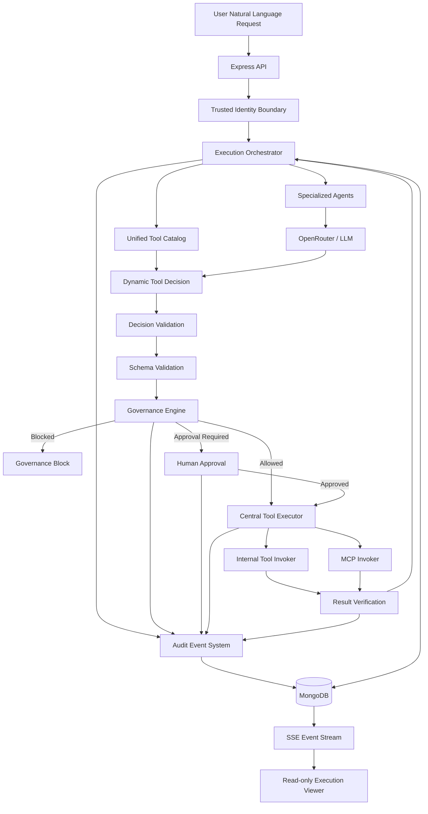
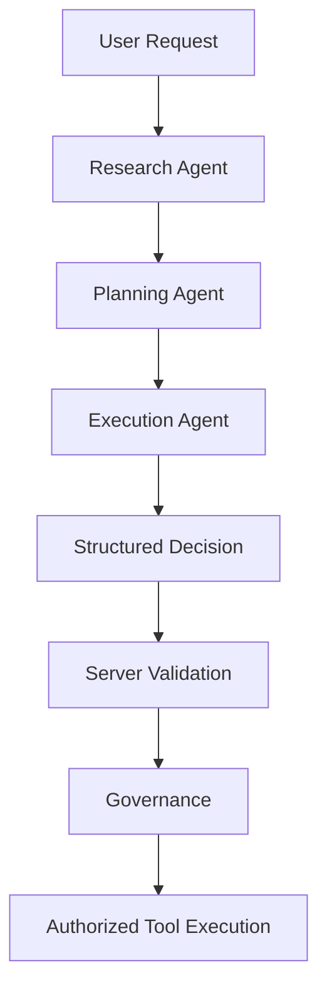
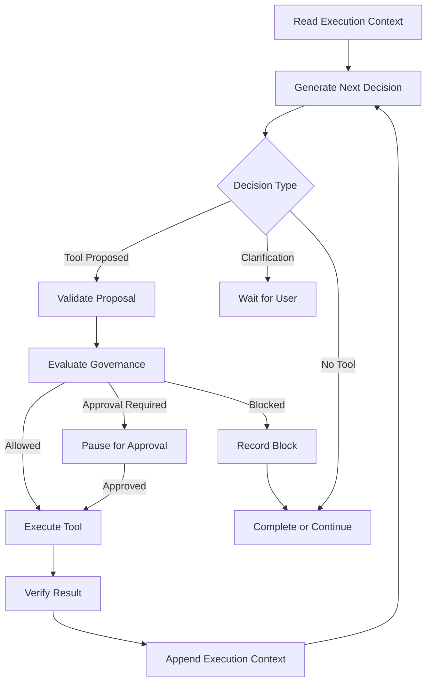
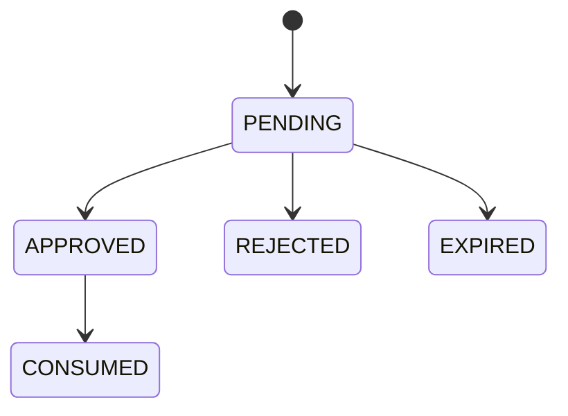
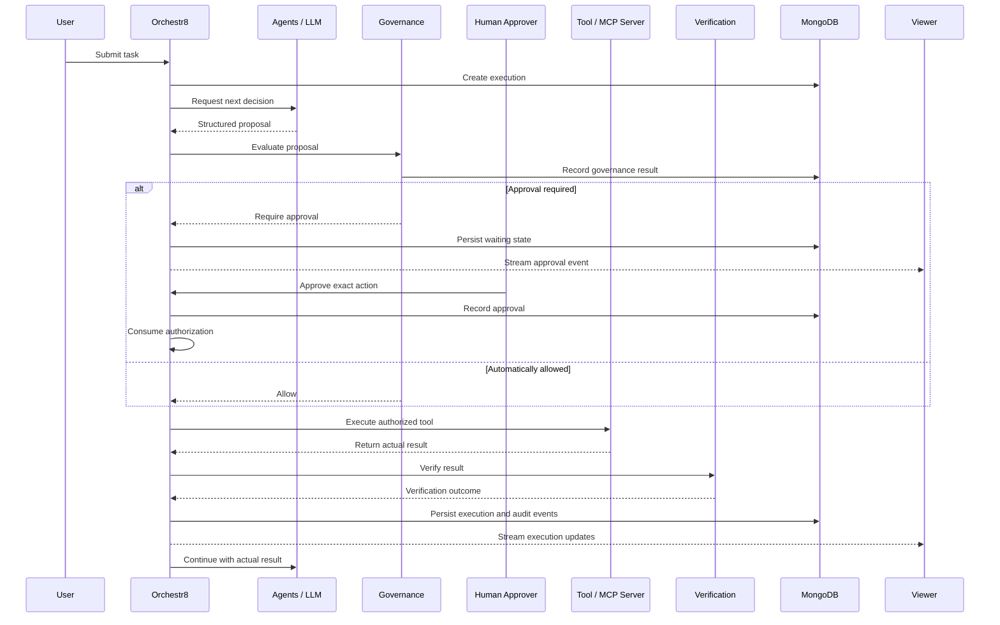

# Orchestr8

### Governed AI-Agent Workflow Orchestration & Observability Platform

> *Give an agent a task. Define the rules. Watch how it works. Audit everything.*

Orchestr8 is an AI-agent orchestration platform designed to demonstrate how autonomous, multi-step agent workflows can operate under deterministic governance. It allows a user to submit a natural-language task, lets specialized agents reason about the work, dynamically discovers and selects tools, evaluates proposed actions against governance policies, requests human approval for sensitive operations, executes authorized actions, verifies their outcomes, and records an auditable history of the entire execution.

The platform combines AI-driven planning with deterministic execution controls.

**The central design principle**: The model proposes. Orchestr8 decides. The executor acts. Verification checks. The audit system records.

---

## Table of Contents

- [1. Project Overview](#1-project-overview)
- [2. Core Design Principles](#2-core-design-principles)
- [3. System Architecture](#3-system-architecture)
- [4. Technology Stack](#4-technology-stack)
- [5. Agent Architecture](#5-agent-architecture)
- [6. Tool Discovery and MCP Integration](#6-tool-discovery-and-mcp-integration)
- [7. Dynamic Reasoning and Tool Selection](#7-dynamic-reasoning-and-tool-selection)
- [8. Schema Validation](#8-schema-validation)
- [9. Governance Engine](#9-governance-engine)
- [10. Human Approval and Exact-Action Authorization](#10-human-approval-and-exact-action-authorization)
- [11. Governed Tool Execution](#11-governed-tool-execution)
- [12. Result Verification](#12-result-verification)
- [13. Audit Architecture and Cryptographic Integrity](#13-audit-architecture-and-cryptographic-integrity)
- [14. Persistence Architecture](#14-persistence-architecture)
- [15. Execution Lifecycle](#15-execution-lifecycle)
- [16. Curated Workflow Demonstrations](#16-curated-workflow-demonstrations)
- [17. Live Execution Viewer](#17-live-execution-viewer)
- [18. Real-Time Event Streaming](#18-real-time-event-streaming)
- [19. API Reference](#19-api-reference)
- [20. Database Collections](#20-database-collections)
- [21. Security Architecture](#21-security-architecture)
- [22. Project Development Phases](#22-project-development-phases)
- [23. Testing and Validation](#23-testing-and-validation)
- [24. Local Development Setup](#24-local-development-setup)
- [25. Configuration and Environment Variables](#25-configuration-and-environment-variables)
- [26. Repository Structure](#26-repository-structure)
- [27. Current Limitations and Future Work](#27-current-limitations-and-future-work)

---

## 1. Project Overview

Modern AI agents can reason about tasks, generate plans, interact with external systems, and perform multi-step operations. However, allowing a language model to directly control external tools introduces significant risks.

A model may:
- Select an inappropriate tool.
- Generate invalid arguments.
- Attempt an operation outside its intended scope.
- Perform an irreversible mutation without authorization.
- Misinterpret a successful tool response as proof of a successful operation.
- Lose execution context between multiple steps.
- Produce an incomplete or misleading record of what happened.

Orchestr8 addresses these problems by separating reasoning from authorization and execution.

Instead of allowing an LLM to directly invoke external services, Orchestr8 places a deterministic orchestration and governance layer between the model and every tool.

### What Orchestr8 does
- Accepts natural-language user instructions.
- Creates an execution context.
- Invokes specialized agents where appropriate.
- Discovers available tools dynamically.
- Allows the model to propose the next suitable tool.
- Validates the proposed tool and arguments.
- Evaluates applicable governance policies.
- Requests human approval when required.
- Executes authorized operations through a centralized executor.
- Verifies operation results through read-back where possible.
- Records execution and governance events.
- Streams execution progress to a read-only viewer.

### What Orchestr8 is not
- A conventional chatbot.
- A static collection of predefined agent chains.
- An unrestricted LLM function-calling wrapper.
- A workflow graph editor.
- A tool that trusts model-generated claims about successful execution.
- A system that exposes private model chain-of-thought as an audit record.

The platform records structured decisions, evidence, arguments, tool outputs, policy evaluations, approvals, and verification results rather than private chain-of-thought.

---

## 2. Core Design Principles

| Principle | Implementation |
| :--- | :--- |
| **Model proposes, system decides** | Model-generated tool decisions pass through server-side validation and governance |
| **Deterministic governance** | Policies are evaluated by application code, not delegated to the LLM |
| **Dynamic tool selection** | Available tools are discovered and presented through a unified catalog |
| **Centralized execution** | External tool calls pass through one controlled execution boundary |
| **Human oversight** | Sensitive operations require explicit approval |
| **Exact-action authorization** | Approval is cryptographically bound to a specific action and its arguments |
| **Verification** | Mutations are checked through subsequent read-back operations where supported |
| **Append-only audit** | Execution events are recorded with sequence and hash information |
| **Observable execution** | The viewer renders actual execution events |
| **Minimal infrastructure** | Node.js, Express, MongoDB and external integrations |
| **Separation of concerns** | Routes → Controllers → Services → Repositories |

The system maintains three distinct forms of truth:
1. **Execution truth**: What actually ran, what returned a result, and what failed.
2. **Governance truth**: What policies were evaluated, what was allowed, what was blocked, and what required approval.
3. **Audit truth**: What was recorded, in what order, and whether the recorded event chain passes integrity verification.

These must remain distinct. A successful tool response does not automatically imply governance compliance or successful verification.

---

## 3. System Architecture

Orchestr8 uses a layered Node.js backend with specialized services for reasoning, governance, execution, approval, verification, and auditing.

### High-level architecture



### Backend layering

The backend strictly follows:
$$\text{Routes} \longrightarrow \text{Controllers} \longrightarrow \text{Services} \longrightarrow \text{Repositories} \longrightarrow \text{MongoDB / External Integrations}$$

- **Routes**: Define HTTP endpoints and connect requests to the appropriate controllers.
- **Controllers**: Handle HTTP request and response concerns, authentication middleware, and response formatting.
- **Services**: Contain application logic, orchestration, decision-making, policy evaluation, approval, verification, and audit coordination.
- **Repositories**: Encapsulate persistence operations and database access.

### External integration boundaries

The TaskOS MCP integration and OpenRouter model integration are isolated behind dedicated services and clients.

---

## 4. Technology Stack

| Component | Technology | Purpose |
| :--- | :--- | :--- |
| **Runtime** | Node.js v24 | Backend runtime |
| **Language** | JavaScript (ESM) | Application implementation |
| **API** | Express 5 | HTTP API and middleware |
| **Database** | MongoDB Atlas | Persistent execution and audit data |
| **Database driver** | MongoDB native driver | Database operations |
| **Input validation** | Zod | Runtime validation |
| **JSON Schema validation** | AJV Draft 2020-12 | Structured output validation |
| **AI provider** | OpenRouter | LLM inference |
| **Model** | DeepSeek / Nemotron | Reasoning and tool selection |
| **Agent integration** | Model service and structured prompts | Agent execution |
| **External tools** | Model Context Protocol (MCP) | TaskOS integration |
| **MCP client** | `@modelcontextprotocol/client` v2.4.0 | MCP discovery and invocation |
| **Internal artifact generation** | PDFKit | PDF generation |
| **Dashboard generation** | HTML/CSS/SVG | Report and dashboard artifacts |
| **Real-time transport** | Server-Sent Events (SSE) | Live execution updates |
| **Testing** | Vitest | Automated test runner |
| **API testing** | Supertest | HTTP endpoint testing |
| **Configuration** | dotenv | Environment configuration |

### Infrastructure philosophy

The project deliberately avoids unnecessary infrastructure during development. Current architecture does not require:
- Docker
- Redis
- Kubernetes
- A separate microservice deployment for each agent
- A dedicated message broker for the sequential execution engine

MongoDB is used for persistence. SSE is used for browser updates. Agents and orchestration services run within the Node.js application.

---

## 5. Agent Architecture

Orchestr8 separates agent responsibilities rather than relying on a single general-purpose agent to perform every operation. Three specialized agents were implemented:

### 5.1 Research Agent
- **Responsibility**: Gather, organize, and interpret relevant information.
- Typical responsibilities include:
  - Understanding the requested task.
  - Analyzing available project information.
  - Identifying relevant evidence.
  - Highlighting unknowns and assumptions.
  - Producing structured research findings.
- The Research Agent does not directly execute external MCP operations.

### 5.2 Planning Agent
- **Responsibility**: Convert research findings and user requirements into structured plans.
- Typical responsibilities include:
  - Breaking larger objectives into smaller tasks.
  - Identifying task relationships.
  - Establishing execution order.
  - Identifying dependencies.
  - Producing structured implementation plans.
- Planning outputs are validated before they are used by subsequent stages.

### 5.3 Execution Agent
- **Responsibility**: Prepare execution proposals based on the approved plan and available tools.
- It helps determine:
  - What action should happen next.
  - Which tool is suitable.
  - What arguments are required.
  - What dependencies must be satisfied.
  - What expected result should be checked.
- The Execution Agent does not bypass governance or directly invoke MCP tools.

### Agent interaction



Agent invocation is controlled by the orchestration process. Not every workflow requires every agent.

---

## 6. Tool Discovery and MCP Integration

Orchestr8 integrates with TaskOS as an external MCP server. TaskOS remains an independent system. Orchestr8 does not rebuild TaskOS internally.

- **MCP endpoint**: `https://taskos-7pgk.onrender.com/mcp`
- Authentication uses a bearer token configured through the environment.

### MCP implementation

The integration uses the official MCP client and Streamable HTTP transport. The implementation supports:
- Establishing a connection to the MCP server.
- Authenticating with the configured API key.
- Discovering the available tools.
- Reading tool descriptions and input schemas.
- Adding discovered tools to the unified tool catalog.
- Validating proposed calls against the catalog.
- Invoking tools through the central MCP invoker.

### Discovered TaskOS tools

The current discovery implementation reports 12 tools:

| Tool | Purpose |
| :--- | :--- |
| `taskos_server_info` | Retrieve TaskOS server information |
| `project_list` | Discover projects |
| `project_get` | Retrieve project details |
| `task_list` | Retrieve project tasks |
| `task_get` | Retrieve an individual task |
| `report_blockers` | Identify project blockers |
| `task_create` | Create a task |
| `task_update` | Update task details |
| `task_assign` | Assign a task |
| `task_transition` | Change task status |
| `task_comment_create` | Create a task comment |
| `task_dependency_add` | Add a task dependency |

Tool schemas are obtained from the live MCP server. The actual discovered schemas are authoritative.

### Unified tool catalog

Orchestr8 combines two categories of tools:
- **Internal tools**: `dashboard_generator`, `pdf_generator`
- **External MCP tools**: Discovered from TaskOS

The catalog provides a unified view to the decision-making layer, allowing the model to select from available capabilities without requiring the application to hardcode a complete workflow for every possible user request.

### Centralized MCP invocation

The MCP `callTool` operation is restricted to `src/executor/mcp.invoker.js`. The rest of the application must use the central execution boundary rather than invoking MCP directly.

---

## 7. Dynamic Reasoning and Tool Selection

A major architectural decision was to avoid depending entirely on native LLM function calling, as the selected model does not guarantee a consistent native tool-calling format for every response.

Orchestr8 therefore uses a **structured decision protocol**. The model receives:
- The original user request.
- Relevant execution context.
- Previous tool results.
- Available tool descriptions.
- Available tool input schemas.
- The current execution state.

It returns a structured decision describing the next action.

### Decision outcomes

| Decision | Meaning |
| :--- | :--- |
| `TOOL_PROPOSED` | A tool has been proposed for execution |
| `NO_TOOL_REQUIRED` | The next step does not require a tool |
| `CLARIFICATION_REQUIRED` | More user information is necessary |
| `NO_SUITABLE_TOOL` | No available tool can safely perform the requested action |

### Decision validation

A model-generated proposal is treated as untrusted input. The backend validates:
- Whether the decision structure is valid.
- Whether the tool exists.
- Whether the tool belongs to the discovered catalog.
- Whether the server is recognized.
- Whether arguments conform to the tool input schema.
- Whether the decision is compatible with the current execution state.

An LLM response cannot authorize its own operation.

### Multi-step reasoning loop



The actual tool result is fed back into subsequent reasoning steps.

### Execution limits
- Maximum reasoning iterations: `10` by default.
- Maximum tool calls: `15` by default.
- Execution is sequential rather than parallel.

---

## 8. Schema Validation

AI-generated structured data cannot be assumed to be valid. Orchestr8 uses two validation layers:
- **AJV**: AJV with JSON Schema Draft 2020-12 validates structured agent and decision outputs against versioned JSON schemas.
- **Zod**: Zod provides runtime validation for application-level data and request structures.

### Validation and correction

The implementation supports:
1. Initial generation.
2. Structured validation.
3. Error feedback.
4. Maximum of two correction attempts (up to three generation attempts total).

If the output remains invalid, the operation fails with `FAILED_SCHEMA`, preventing malformed agent outputs from flowing into governance or execution.

---

## 9. Governance Engine

Governance is one of the central components of Orchestr8. Instead of asking the LLM whether an operation is safe, Orchestr8 evaluates the proposed action using deterministic application logic.

### 9.1 Policy scope
Policies can be scoped across multiple dimensions: `execution`, `agent`, `tool`, `server`, `action`, `input`, and `output`.

### 9.2 Supported operators
`EQ`, `NEQ`, `GT`, `GTE`, `LT`, `LTE`, `IN`, `NOT_IN`, `CONTAINS`, `EXISTS`.

### 9.3 Default policies

| Policy | Purpose | Scope | Enforcement |
| :--- | :--- | :--- | :--- |
| `approved-servers` | Restrict execution to approved servers | execution | deny |
| `max-tool-calls` | Limit total tool calls ($\le 15$) | execution | deny |
| `max-task-creations` | Limit task creation operations ($\le 5$) | execution | deny |
| `max-dependencies` | Limit dependency creation ($\le 3$) | tool | deny |
| `task-create-approval` | Require approval for task creation | tool | require_approval |
| `task-update-approval` | Require approval for task updates | tool | require_approval |
| `task-assign-approval` | Require approval for task assignment | tool | require_approval |
| `task-transition-approval` | Require approval for task transitions | tool | require_approval |
| `min-desc-length` | Enforce minimum description length ($\ge 10$) | tool | warn |

### 9.4 Policy versioning and snapshots
An execution uses a policy snapshot that is loaded from the policy repository, versioned, canonically serialized, hashed, and deep-frozen before evaluation.

### 9.5 Governance metrics
Maintains execution metrics (limit counters, invocation counts). A proposed call is strictly separated from a completed execution.

### 9.6 Fail-fast behavior
Governance failures immediately halt the operation before it reaches the tool invoker. A model cannot override a deterministic governance rejection.

---

## 10. Human Approval and Exact-Action Authorization

Sensitive mutations require explicit human approval. Approval authorizes one specific proposed operation, not unrestricted agent freedom.

### 10.1 Approval lifecycle



Default approval expiry is 15 minutes (`ttl_ms = 900000`).

### 10.2 Exact-action fingerprint
An approval is bound to a canonical representation:
$$\text{action\_fingerprint} = \text{SHA256}(\text{canonical\_json}(\text{execution\_id}, \text{proposal\_id}, \text{server}, \text{tool\_name}, \text{arguments}, \text{policy\_snapshot\_hash}))$$

Changing the target, arguments, tool, server, or snapshot invalidates the binding.

### 10.3 One-time authorization
An approved authorization is consumed through an atomic conditional state transition (`atomicTransition(id, "APPROVED", { status: "CONSUMED" })`).

### 10.4 Self-approval prevention
A requester cannot approve their own request (`actor.actorId === req.requester_id` throws 403 Forbidden).

### 10.5 Identity boundary
The application uses a trusted identity boundary via `x-trusted-actor-id` and `x-trusted-actor-role`.

---

## 11. Governed Tool Execution

The central execution boundary ensures every tool invocation passes through:
$$\text{Tool Proposal} \rightarrow \text{Validation} \rightarrow \text{Governance} \rightarrow \text{Approval Check} \rightarrow \text{Authorization Consumption} \rightarrow \text{Central Executor} \rightarrow \text{Invoker} \rightarrow \text{Verification} \rightarrow \text{Audit}$$

### 11.1 Central executor
Coordinates tool ownership, server validation, argument validation, governance checks, approval consumption, tool invocation, verification, and audit event recording.

### 11.2 Internal tool invoker
Executes `dashboard_generator` and `pdf_generator`. Confirms generated artifacts are readable.

### 11.3 MCP tool invoker
Directs external operations through the dedicated MCP client connection.

### 11.4 Sequential execution
Reasoning is strictly sequential; subsequent steps receive the preceding step's verified result.

### 11.5 Execution states
`RUNNING`, `WAITING_FOR_APPROVAL`, `WAITING_FOR_USER`, `COMPLETED`, `FAILED`, `BLOCKED`.

---

## 12. Result Verification

A successful tool response is not automatically proof of correct completion. Orchestr8 includes a verification service:
- **Read operations**: Result is validated and recorded.
- **Mutation operations**: Mutations (e.g. `task_create`) are followed by a separate read-back operation (`task_get(taskId)`).
- **Artifact verification**: Checks generated HTML and PDF files for non-zero byte size and readability.

Statuses: `VERIFIED`, `VERIFICATION_FAILED`, `UNVERIFIED`.

---

## 13. Audit Architecture and Cryptographic Integrity

Orchestr8 records an append-only event history of execution and governance activity.

### 13.1 Audit events
Versioned schema with 23 distinct event types covering the full lifecycle.

### 13.2 Hash chain
Uses SHA-256 hash chaining:
- $H_0 = \text{Genesis Hash}$
- $H_n = \text{SHA256}(\text{CanonicalEvent}_n + H_{n-1})$

### 13.3 Canonical serialization
Deterministic key ordering and normalization of undefined values to null ensures hash consistency across MongoDB persistence round-trips.

### 13.4 Hash-chain verification
The audit verifier validates sequence continuity, previous hash linkage, and event hash integrity (`verifyExecutionIntegrity`).

### 13.5 Redaction
Structured secret-key redaction protects credentials before writing to the audit repository.

---

## 14. Persistence Architecture

Persistent records are stored in MongoDB Atlas:
```
orchestr8 (Database)
├── executions      # Execution state and lifecycle records
└── audit_events    # Append-only execution and governance event stream
```

### Indexing
`audit_events` utilizes a unique compound index on `{ execution_id: 1, sequence_number: 1 }` to prevent duplicate sequence numbers.

---

## 15. Execution Lifecycle



---

## 16. Curated Workflow Demonstrations

Orchestr8 includes five curated scenarios:

### Workflow 01 — Project Intelligence
- **Type**: Read-only workflow
- **Flow**: `project_list` $\rightarrow$ `project_get` $\rightarrow$ `task_list` $\rightarrow$ `report_blockers` $\rightarrow$ `dashboard_generator` $\rightarrow$ `pdf_generator`
- **Demonstrates**: Discovery, multi-step inspection, dashboard/PDF artifact generation.

### Workflow 02 — Task Creation & Verification
- **Type**: Approval-gated mutation
- **Flow**: `project_list` $\rightarrow$ `task_list` $\rightarrow$ `task_create` $\rightarrow$ `WAITING_FOR_APPROVAL` $\rightarrow$ Human approval $\rightarrow$ `task_get` read-back verification
- **Demonstrates**: Approval pause, exact-action authorization, live mutation, read-back verification.

### Workflow 03 — Blocker Resolution
- **Type**: Approval-gated transition
- **Flow**: `report_blockers` $\rightarrow$ `task_transition` $\rightarrow$ `WAITING_FOR_APPROVAL` $\rightarrow$ Human approval $\rightarrow$ State refresh
- **Demonstrates**: Blocker identification and protected status transitions.

### Workflow 04 — Project Execution Review
- **Type**: Read-only workflow
- **Flow**: `project_list` $\rightarrow$ `project_get` $\rightarrow$ `task_list` $\rightarrow$ Analysis $\rightarrow$ Executive PDF
- **Demonstrates**: Project assessment, risk identification, management reporting.

### Workflow 05 — Project Plan Execution
- **Type**: Multi-action approval
- **Flow**: Discovery $\rightarrow$ Planning Agent $\rightarrow$ Task 1 create $\rightarrow$ Approval 1 $\rightarrow$ Task 2 create $\rightarrow$ Approval 2 $\rightarrow$ Add dependency $\rightarrow$ Verify
- **Demonstrates**: Multi-agent planning, sequential approvals, dependency management.

---

## 17. Live Execution Viewer

Access: `http://localhost:5000/` or `http://localhost:5000/viewer/`

The viewer provides:
- **Curated workflow launch controls**: One-click execution of curated flows or custom NLP prompts.
- **Sequential execution timeline**: Displays node progression (`QUEUED`, `RUNNING`, `COMPLETED`, `WAITING_FOR_APPROVAL`).
- **Node inspector**: Displays inputs, outputs, execution duration, and audit hash linkage.
- **Governance inspector**: Shows individual policy evaluations with metric comparisons.
- **Approval action bar**: Approves or rejects gated proposals directly from the UI.
- **Real-time audit stream**: Chronological cryptographic event stream.

---

## 18. Real-Time Event Streaming

- **Endpoint**: `GET /api/executions/:executionId/stream`
- **Transport**: Server-Sent Events (SSE)
- Streams historical events on connection and live audit events as they occur.

---

## 19. API Reference

### Health
- `GET /health` — Application status and MongoDB connection verification.

### Executions
- `POST /api/executions` — Submit a new execution.
  - Headers: `x-trusted-actor-id: <id>`, `x-trusted-actor-role: <role>`
  - Body: `{ "message": "Natural language command" }`
- `GET /api/executions/:id` — Retrieve execution state and completed tool calls.
- `GET /api/executions/:id/events` — Retrieve raw execution events.
- `GET /api/executions/:executionId/stream` — SSE event stream.
- `POST /api/executions/:id/resume` — Resume a paused execution.
  - Body: `{ "approval_id": "<id>" }`

### Approvals
- `POST /api/approvals/:id/approve` — Approve a pending proposal.
- `POST /api/approvals/:id/reject` — Reject a pending proposal.
- `GET /api/approvals/:id` — Retrieve approval request details.

### Audit
- `GET /api/audit/:executionId` — Retrieve audit trail and verify hash integrity.

---

## 20. Database Collections

Database: `orchestr8`

| Collection | Description | Key Indexes |
| :--- | :--- | :--- |
| `executions` | Execution lifecycle records | `execution_id` (unique) |
| `audit_events` | Append-only audit events | `execution_id + sequence_number` (unique compound) |

---

## 21. Security Architecture

1. **External tool boundary**: Central executor controls all MCP interactions.
2. **Schema enforcement**: All model outputs are checked with AJV and Zod.
3. **Deterministic policies**: Evaluated in application logic prior to invocation.
4. **Exact-action fingerprinting**: Approvals are bound cryptographically to specific arguments.
5. **Atomic consumption**: Prevents replay attacks on approvals.
6. **Self-approval prevention**: Requesters cannot approve their own proposals.
7. **Append-only audit with SHA-256 chaining**: Detects any historical log tampering.
8. **Credential isolation**: Keys are loaded from environment variables and redacted from logs.

---

## 22. Project Development Phases

- **Phase 0 — Foundation and Backend Architecture** (`4bf3268`): Express 5, MongoDB Atlas, Vitest.
- **Phase 1 — Model Laboratory**: OpenRouter inference integration.
- **Phase 2 — Specialized Agent Architecture** (`72eba25`): Research, Planning, Execution agents.
- **Phase 3 — Schema Compliance** (`de62e6c`): AJV Draft 2020-12, error feedback, correction loop.
- **Phase 4 — Internal Tool Infrastructure** (`dcbe1dc`): PDFKit, HTML/SVG dashboards.
- **Phase 5 — TaskOS MCP Integration** (`2374e8d`): Streamable HTTP MCP client, discovery.
- **Phase 6 — Dynamic Reasoning and Tool Selection** (`7da9480`): Unified catalog, decision service.
- **Phase 7 — Governance Policy Engine** (`343955b`): 9 default policies, snapshots, hash freezing.
- **Phase 8 — Human Approval and Exact-Action Authorization** (`2dfdfbf`): SHA-256 fingerprinting.
- **Phase 9 — Unified Append-Only Audit System** (`0b0d0c3`): 23 event types, SHA-256 chaining.
- **Phase 10 — Governed Tool Execution and Verification** (`0d081a3`): Central executor, read-back verification.
- **Phase 10.1 — Persistence and Security Correction**: MongoDB persistence for execution and audit data.
- **Phase 11 — Curated Workflows and Live Execution Viewer** (`c1b04da`): SSE stream, interactive viewer.
- **Phase 11.1 — Live Validation, Persistence and Audit Corrections** (`61048b8`): Live MCP and MongoDB validation.

---

## 23. Testing and Validation

- **Test Suite**: Vitest (67 test files, 182 tests passing).
- **Rule Compliance**: All `.js`, `.ts` files strictly $< 50$ lines ($\le 49$ lines).
- **Coverage**: Unit, integration, workflow tests, and live MCP connectivity suites.

```bash
npx vitest run
```

---

## 24. Local Development Setup

### Prerequisites
- Node.js v24+
- MongoDB Atlas cluster
- OpenRouter API key
- TaskOS MCP instance running

### Installation

```bash
git clone https://github.com/AbhayankarBellur/orchestr8.git
cd orchestr8
npm install
```

### Environment Configuration

Create a `.env` file in the project root:

```env
PORT=5000
MONGODB_URI=mongodb+srv://<username>:<password>@cluster.mongodb.net
MONGODB_DB_NAME=orchestr8
OPENROUTER_API_KEY=your_openrouter_key
OPENROUTER_MODEL=deepseek/deepseek-chat
TASKOS_MCP_URL=https://taskos-7pgk.onrender.com/mcp
TASKOS_API_KEY=your_taskos_key
```

### Running the Application

```bash
npm run dev
```

Open `http://localhost:5000/viewer/` to view the live interface.

---

## 25. Configuration and Environment Variables

| Variable | Description |
| :--- | :--- |
| `PORT` | Express server port (default: 5000) |
| `MONGODB_URI` | MongoDB Atlas connection string |
| `MONGODB_DB_NAME` | Database name (default: `orchestr8`) |
| `OPENROUTER_API_KEY` | API key for OpenRouter LLM inference |
| `OPENROUTER_MODEL` | Model identifier (default: `deepseek/deepseek-chat`) |
| `TASKOS_MCP_URL` | TaskOS Streamable HTTP MCP URL |
| `TASKOS_API_KEY` | Bearer token for TaskOS authentication |

---

## 26. Repository Structure

```
orchestr8/
├── src/
│   ├── agents/          # Research, Planning, Execution agents
│   ├── approval/        # Action fingerprinting and nonces
│   ├── audit/           # Hasher, verifier, redaction
│   ├── config/          # Database, model, MCP configs
│   ├── controllers/     # Execution, approval, audit controllers
│   ├── executor/        # Central executor, MCP and internal invokers
│   ├── governance/      # Policy evaluator, guard, metrics, snapshots
│   ├── llm/             # OpenRouter and model client
│   ├── mcp/             # MCP client, discovery, catalog
│   ├── middleware/      # Auth, error handling
│   ├── orchestrator/    # Decision loop, prompts, validator
│   ├── repositories/    # MongoDB execution and audit repositories
│   ├── routes/          # API endpoints
│   ├── schemas/         # Zod and JSON schemas
│   ├── services/        # Orchestration, approval, verification
│   ├── tools/           # PDF and dashboard generators
│   ├── app.js           # Express application setup
│   └── server.js        # Server entrypoint
├── public/              # Observability viewer UI (HTML/JS/Tailwind)
├── scratch/             # Reusable proof scripts (prove.js, prove_task_create.js)
├── tests/               # 67 Vitest test suites (182 tests)
├── .env                 # Environment variables (ignored)
├── package.json
└── README.md
```

---

## 27. Current Limitations and Future Work

1. **Distributed Concurrency**: Process-local audit sequencing should be extended with distributed MongoDB transactions for multi-instance deployments.
2. **Advanced Redaction**: Deep scanning of free-text inputs for embedded tokens.
3. **Recovery After Crash**: Resuming executions across application restarts without re-evaluating completed idempotent tools.

---

## Quick Start: Running Governed Workflows in Terminal

### 1. Project Detail Fetch (Read-Only Governed Flow)
Demonstrates discovery, model reasoning, schema validation, policy evaluation, live MCP tool execution, and SHA-256 audit chaining:

```cmd
cd C:\Users\abhay\orchestr8
node scratch\prove.js "Fetch project details for Backend Migration"
```

### 2. Task Creation with Exact-Action Approval (Mutating Governed Flow)
Demonstrates human approval pause, fingerprint binding, live TaskOS creation, and read-back verification:

```cmd
cd C:\Users\abhay\orchestr8
node scratch\prove_task_create.js "Configure Redis Caching Layer" "Deploy high-availability Redis instance for user sessions" "high"
```
